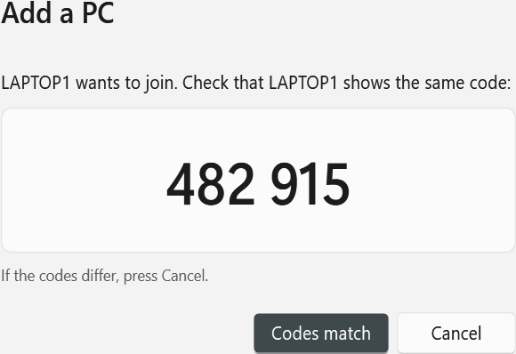
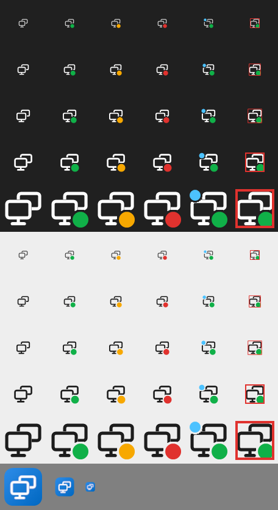
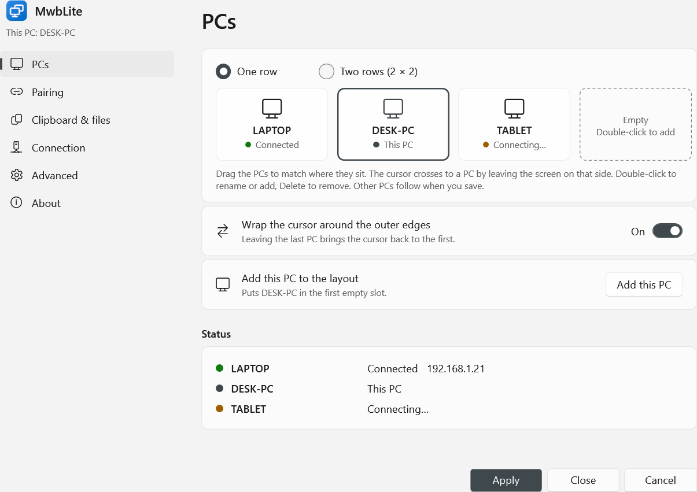
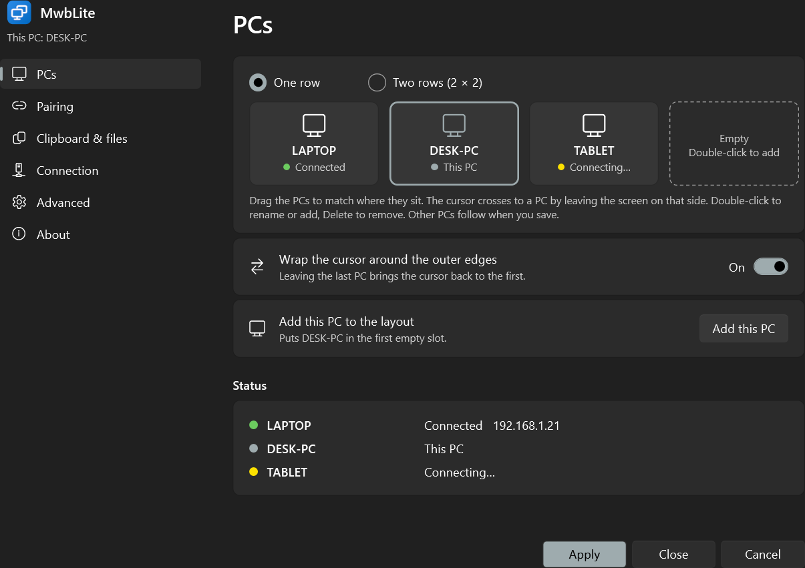
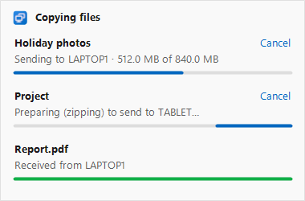
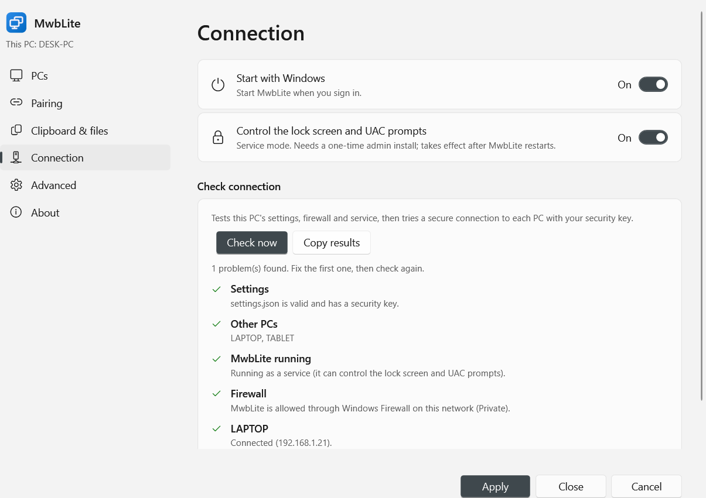
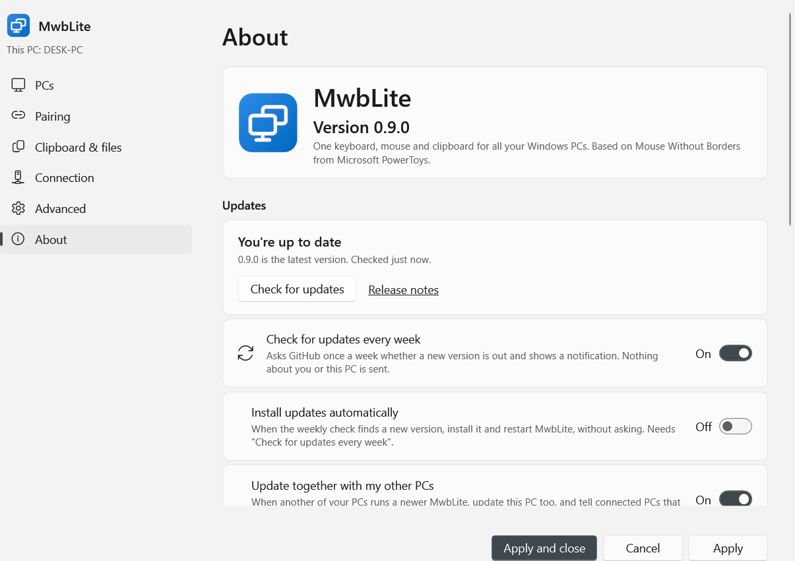

# MwbLite: standalone Mouse Without Borders

MwbLite is [Mouse Without Borders](https://learn.microsoft.com/windows/powertoys/mouse-without-borders) (MWB) carved
out of Microsoft PowerToys so it runs on its own: one tray app plus a small helper, configured by a JSON file.
It has no PowerToys runner, Settings app, updater, telemetry or Group Policy layer.

It is built from PowerToys commit `cf45de41` (see [UPSTREAM.md](UPSTREAM.md)). The networking, encryption,
input-injection and clipboard code is upstream's, unchanged apart from the lines listed in
[Changes to upstream code](#changes-to-upstream-code).

> MIT licensed, like PowerToys. [LICENSE](LICENSE) and [NOTICE.md](NOTICE.md) are upstream's; the original
> copyright headers are kept in every source file.

## Build

Requirements: Windows 10/11 x64, PowerShell 5.1 (built in), internet access for the first build. No Visual
Studio, C++ tools, WiX install or system-wide .NET SDK are needed.

```bat
build.cmd
```

That single command (a wrapper for `powershell -NoProfile -ExecutionPolicy Bypass -File build.ps1`) does four things:

1. **Installs the SDK.** It downloads the .NET SDK pinned in `global.json` into `.dotnet\` (portable). The
   Microsoft-signed `dotnet-install.ps1` is checked for a valid signature before it runs.
2. **Runs the unit tests.** These are upstream's encryption, key-codec, logger and received-file tests plus the
   config tests. Pass `-SkipTests` to skip them.
3. **Publishes the app** twice: as a small folder that runs on the shared .NET 10 Desktop Runtime (for the
   installer), and as portable single-file exes that carry their own runtime.
4. **Builds the installer** with the [WiX Toolset](https://wixtoolset.org) 5, which comes from NuGet (MS-RL
   licence). Pass `-SkipInstaller` to skip it.

Output in `dist\`:

| File | Size | Use |
|---|---|---|
| `MwbLite-Setup-<version>.exe` | ~8 MB | **The installer.** Double-click it on each PC. Installs the .NET Desktop Runtime first if the PC needs it. |
| `MwbLite-<version>-x64.msi` | ~7 MB | The app package alone, for silent or scripted installs on PCs that already have the .NET 10 Desktop Runtime: `msiexec /i MwbLite-<version>-x64.msi /qn` |
| `portable\MwbLite.exe`, `portable\MwbLite.Helper.exe` | ~74 MB each | Run without installing (see [Portable use](#portable-use-no-installer)). |
| `SHA256SUMS.txt` | | Hashes of all of the above. |

Artwork and screenshots are generated from code, so they stay consistent:

- `tools\make-art.ps1` regenerates the app icon (`src\App\Logo.ico`) and Setup's images (`installer\Assets`)
  from `src/App/Lite/Ui/LiteArt.cs`. The outputs are committed; run it only after changing the artwork.
- `MwbLite.exe --render-ui <folder>` renders every Settings page, the pairing window and the progress window, in
  light and dark mode, to PNG files (used for the images in this README).

The build keeps everything inside the repo folder:

- NuGet packages go to `.nuget\` and come from nuget.org only.
- The SDK's CLI state goes to `.dotnet\home`.
- .NET CLI telemetry is switched off.

The installed app uses the **shared .NET 10 Desktop Runtime** (about 31 MB of its own files). Setup checks for
the runtime version pinned in `installer\DotNetRuntime.props`; if it's missing or older, Setup downloads
Microsoft's installer (about 57 MB), checks its SHA-512, and runs it. Windows Update then keeps the runtime
patched, and uninstalling MwbLite leaves it in place for other apps. To move to a newer .NET 10 patch, run
`tools\update-runtime-pin.ps1` and build.

Each portable exe carries its own .NET runtime, so they are large, and since 0.9.0 they are compressed (about
74 MB each instead of 178 MB). The price is that a compressed exe is inflated into private memory when it starts:
measured on the Settings window, about 80 MB more RAM and 70 ms more start time. The installed (framework-dependent)
build is not compressed, so installing with Setup is unchanged.

## Install

**Don't run PowerToys' Mouse Without Borders on the same PC** (turn it off in PowerToys): both use TCP ports
15100/15101.

### With Setup (recommended)

Download `MwbLite-Setup-<version>.exe` from the project's
[Releases](https://github.com/nozinoz/MwbLite/releases) page (or build it), and run it on each PC. The version
is shown on Setup's banner and in its title. Tick **I agree to the licence terms** (the link opens them), leave
**Start MwbLite when I sign in** ticked if you want that, press **Install**, approve the UAC prompt, then **Open
MwbLite**. Setup:

- installs Microsoft's **.NET 10 Desktop Runtime** if the PC doesn't have a recent enough one (needs internet
  the first time);
- installs to `C:\Program Files\MwbLite` and adds an entry in **Settings > Apps > Installed apps** (Uninstall
  is there);
- adds **MwbLite** and **MwbLite Settings** to the Start menu;
- registers the **MwbLite.Service** Windows service (demand start; local users may start and stop it), used for
  lock screen and UAC prompt control;
- adds inbound Windows Firewall rules for `MwbLite.exe`, from the **local subnet** only: TCP (MWB, MwbLite's own
  control connection and pairing) and UDP 15102 (finding PCs for pairing). See [Ports and firewall](#ports-and-firewall);
- adds the **MwbLite Update** scheduled task, which lets you install updates without a UAC prompt (see
  [Updates and the About page](#updates-and-the-about-page));
- turns on **Start with Windows** for you if the box was ticked (from the command line: `StartWithWindows=0` to
  leave it off);
- closes running copies of MwbLite first, so re-running a newer Setup **upgrades in place** and keeps your
  settings.

**Uninstall** removes all of that (including the update task), plus `%ProgramData%\MwbLite` and your
start-with-Windows entry. Your own
settings in `%LOCALAPPDATA%\MwbLite` are kept.

### First-time setup: pair with a code

MwbLite starts in the tray. On first run it creates `%LOCALAPPDATA%\MwbLite\settings.json` with a random
security key and shows a balloon. Left-click the tray icon to open **Settings** (see
[Settings window](#settings-window)).

**First PC** (e.g. the mini PC): turn on **Start with Windows** (Connection page) and press **Apply**. Its random key is the
one every PC will use.

**Each other PC**, one at a time, with both PCs on the same network:

1. On the first PC: Settings > **Add a PC…** It waits up to 5 minutes.
2. On the new PC: Settings > **Join…** It lists the PCs that are waiting; pick one and press **Join** (or type its
   name if it isn't listed).
3. Both PCs show the same 6-digit code. Check they match and press **Codes match** on **both**.



The new PC receives the security key, the machine list (with itself added), the layout and the port. Both PCs
save and apply them at once, and any PCs already connected pick up the new layout automatically. Then tick
**Start with Windows** on the new PC too. Drag the tiles on the **PCs** page on any PC to match your desk; the others
follow.

You can still do it by hand instead: **Copy** the key from one PC, paste it on the others, and enter the same
machine names everywhere. See [How pairing works](#how-pairing-works).

### Lock screen and UAC prompts (service mode)

1. In Settings > Connection, turn on **Control the lock screen and UAC prompts**, press **Apply**, and approve the UAC prompt. That copies your
   settings to `%ProgramData%\MwbLite`, a folder only SYSTEM and Administrators can read (see
   [Security notes](#security-notes)).
2. Exit MwbLite from the tray and start it again from the Start menu (or sign out and back in).

From then on, at sign-in:

- MwbLite starts the service and exits.
- The service launches MwbLite as SYSTEM on the secure desktop and on your desktop (exactly as PowerToys does),
  then stops itself.
- Later setting changes ask for UAC approval to update the protected copy.

### Portable use (no installer)

Copy `dist\portable\` anywhere and run `MwbLite.exe`. Windows Firewall will ask on first run; allow
**private networks**. For service mode without Setup, run `MwbLite.exe --install` (UAC). It copies the exes to
`C:\Program Files\MwbLite`, registers the service, adds firewall rules (TCP `tcpPort`, `tcpPort+1`, `tcpPort+3` and 15102, UDP 15102) from the
local subnet, and copies your settings to `%ProgramData%`. It does not add the update task, so updating a portable
copy still asks for UAC. `MwbLite.exe --uninstall` removes it again. These two
commands do nothing on a PC where Setup installed MwbLite.

### Commands

| Command | Admin | What it does |
|---|---|---|
| `MwbLite.exe` | no | Run as a tray app. With `useService: true`, it starts the service and exits. |
| `MwbLite.exe --settings` | no | Open the Settings window. |
| `MwbLite.exe --open-config` | no | Open your settings.json in Notepad. |
| `MwbLite.exe --apply-config` | UAC | Copy your settings.json to the service's protected copy. |
| `MwbLite.exe --install` | UAC | Portable only: install service, firewall rule and Program Files copy (see above). |
| `MwbLite.exe --uninstall` | UAC | Portable only: remove what `--install` added. |
| `MwbLite.exe --service` | — | Service entry point. The Service Control Manager uses this; don't run it by hand. |
| `MwbLite.exe --set-layout …` | — | Internal: a service-mode instance uses it to save a layout received from another PC into your settings.json. |
| `MwbLite.exe --set-alignment …` | — | Internal: the same for a screen alignment received from another PC. |
| `MwbLite.exe --register-update-task`, `--unregister-update-task` | SYSTEM | Internal: Setup runs these to add and remove the **MwbLite Update** task. |
| `MwbLite.exe --install-update` | SYSTEM | Internal: what the **MwbLite Update** task runs; installs the newest release (see [Updates](#updates-and-the-about-page)). |

### Tray menu

- **Settings…** Also what a left-click on the icon does. See [Settings window](#settings-window).
- **Open config file.** Opens settings.json in Notepad.
- **Reload config.** Re-reads settings.json after you edit it by hand.
- **Exit.**
- **Your PCs.** Below Exit, every PC in the layout with its state: *This PC*, *Connected*, *Connecting…*, *Not
  connected* or *Security key doesn't match*. Click a connected PC to move the mouse and keyboard there.
- **Wake LAPTOP** (with each PC's own name). Below the list, one item for each PC that isn't connected and whose
  network card address MwbLite knows. It sends a Wake-on-LAN signal (see [Waking, locking and sleeping PCs](#waking-locking-and-sleeping-pcs)).
- **Lock all PCs** and **Sleep all PCs…** lock or sleep every connected PC and this one. Sleep asks first.

The icon is two screens, drawn white or black to match your taskbar, with a **status dot**:

| Dot | Meaning |
|---|---|
| green | every PC in the layout is connected |
| amber | connecting… |
| red | a PC is offline, has a different security key, or runs an older version |
| none | no other PCs set up yet |

A small blue dot at the top left means a clipboard or file copy is under way, and a red outline means "control all
PCs" mode is on. Hover over the icon for a summary ("MwbLite – 2 of 3 PCs connected", one line per PC, or the file
being copied and how far it has got). If a PC is rejected because its security key is different, or because it
runs an older version, a notification says so once. A PC that was connected and then stays gone for 20 seconds also
gets a notification, and another when it is back (see [Connection notices](#connection-notices)).



### Settings window



Left-click the tray icon, or choose **Settings…**. The window looks and works like Windows 11 Settings: pages in a
sidebar, cards and switches, and light or dark mode following Windows (it uses WPF's Fluent theme from .NET).

- **PCs.** Your PCs as tiles in MWB's 4 slots, each with its live state (green Connected, amber Connecting, red
  otherwise), plus a status list. **Drag a PC** onto another slot to move it there; it swaps with whatever is in
  that slot. **One row** places them left to right; **Two rows (2 × 2)** turns the slots into a grid (`[1][2]`
  over `[3][4]`) for a PC above or below another. **Wrap the cursor** and **Add this PC** are here too, and below
  them **Line up screens** for neighbours whose screens differ in size (see
  [Lining up screens of different sizes](#lining-up-screens-of-different-sizes)).
  - Double-click a tile or an empty slot to rename or add a PC; press Delete to remove one. The right-click menu
    does the same.
  - Keyboard: the arrow keys select a slot, Ctrl+arrows move the selected PC, and F2 renames.
  - This PC is highlighted. Save, and the other connected PCs take the new arrangement and save it too.
- **Pairing.** **Add a PC…** / **Join…** to pair with a code (see
  [First-time setup](#first-time-setup-pair-with-a-code)).
- **Clipboard & files.** Clipboard, file transfer and the copy progress window.
- **Connection.** Start with Windows, service mode, **Tell me when a PC connects or drops off** (see
  [Connection notices](#connection-notices)), and **Check connection** with its results on the page (see
  [Check connection](#check-connection)).
- **Advanced.** The **security key** (set by pairing; **Show**, **Copy** and **Reset pairing…**, which makes a new
  key so this PC stops working with the others until they're paired again), port, Easy Mouse, hotkeys,
  name-to-IP mappings, the less common switches, **Allow older versions**, and **Open in Notepad**.
- **About.** Version and details, links, **Save diagnostics…**, the update status and **Update now**, and the
  switches **Check for updates every week**, **Install updates automatically** and **Update together with my other
  PCs** (see [Updates and the About page](#updates-and-the-about-page)).
- **Apply** (or Ctrl+S) validates first, using the same checks as Reload config. If something is wrong, the
  problem is shown in red at the bottom. Otherwise it writes settings.json, the running MwbLite picks it up, and the
  window stays open:
  - **Normal mode:** MwbLite notices the saved file and reloads straight away.
  - **Service mode:** a UAC prompt copies it to the service's protected copy.
  - **Service mode turned on but not installed yet:** the window offers the one-time install.
- **Apply and close** works like OK in a classic dialog: it applies your changes (as above) and closes the window;
  if they can't be saved, the window stays open with the problem shown. **Cancel** discards your changes and closes.
  Esc, or the window's close button, asks whether to apply changes you haven't applied.
- **Saving rewrites settings.json.** Comments are removed (you're asked first), and the previous file is kept as
  `settings.json.bak`. Values the window doesn't show (e.g. `easyMouseFullscreenExcludedApps`) are kept.
- **It runs as you, in its own process** (`MwbLite.exe --settings`), never as SYSTEM, in normal and service mode
  alike.



## Arranging the PCs

Open Settings and drag the tiles on the **PCs** page until they match where the PCs sit on your desk,
then press **Apply**. The cursor moves to a PC by leaving the screen on that side.

- **One row:** tiles left to right. With `LAPTOP1, MINIPC, LAPTOP2`, the mini PC's left edge leads to LAPTOP1 and
  its right edge to LAPTOP2.
- **Two rows (2 × 2):** for a PC above or below another. Leave a slot empty where there's no PC; that edge then
  doesn't switch.
- **Wrap the cursor around the outer edges:** leaving the last PC brings you back to the first. Untick it to cross
  only between PCs that are next to each other.
- **Each PC counts as one screen**, however many monitors it has. MWB uses the outer edges of that PC's whole
  desktop; the edges between its own monitors work as normal Windows.
- **Offline PCs and empty slots are skipped.** With LAPTOP1 asleep, the cursor goes to the next PC that's online.
- **Keyboard:** Ctrl+Alt+F1…F4 jump to the PC in slot 1…4. To use Ctrl+Alt+1…4 instead, change "Switch to PC"
  under advanced settings.
- **Only two shapes:** MWB supports a row of up to 4 or a 2×2 grid, not free-form positions.

### Lining up screens of different sizes

MWB maps the cursor's position along the shared edge proportionally: the top of one screen lands on the top of the
next. With a tall monitor next to a small laptop screen that sits lower on the desk, that isn't where the cursor
should come out. Settings > PCs > **Line up screens** has one row for each pair of neighbouring PCs in the layout:

- A diagram shows the two screens side by side (or stacked, in the 2 × 2 layout). **Drag** the second screen along
  the first one's edge and **drag its ends** to resize it, or use the **Position** and **Size** sliders (also the
  way to do it from the keyboard).
- **Use real sizes** asks both PCs for the physical size of their primary screen (as Windows reports it) and sets
  the second screen to its true size relative to the first, centred on it. It is only offered while both PCs are
  connected and run 0.9.0 or later.
- **Reset** goes back to MWB's proportional mapping.
- Nothing is saved until **Apply**. The entries are stored in settings.json under `advanced.edgeAlignment`, and
  pairs that are no longer neighbours in the layout are dropped.
- **Other PCs follow.** In the default relative mouse mode the PC the cursor is on works out where it comes out, so
  every PC needs the same entries. Apply sends them to the connected PCs, which save them. A PC that is off at that
  moment keeps its old entries until you apply again.

Each PC counts as one screen here too, as in [Arranging the PCs](#arranging-the-pcs): the entries apply to the
edges of its whole desktop.

## Waking, locking and sleeping PCs

These use MwbLite's own control connection (see [Ports and firewall](#ports-and-firewall)), so **every PC involved
needs 0.9.0 or later**.

- **Lock all PCs** locks every connected PC, then this one. **Sleep all PCs…** asks first, then puts every connected
  PC to sleep (not hibernate), then this one. Both are in the tray menu. In service mode the lock is run as the
  signed-in user.
- **Wake LAPTOP** (the PC's own name) sends a Wake-on-LAN "magic packet" to a PC that isn't connected, then redials it every few seconds for
  two minutes so it connects as soon as it is up. The item appears only for a PC whose network card (MAC) address is
  known. MwbLite learns it while the PC is connected: from the PC itself (0.9.0 or later), or, for an older MwbLite,
  from the ARP cache. It is kept in `addresses.json` next to settings.json. So a PC must have been connected to this
  one once before it can be woken. The addresses are kept per Windows account: in service mode, the SYSTEM tray and
  your own learn them separately.
- **Wake-on-LAN needs the sleeping PC's network card to be listening.** That is usually **wired Ethernet** with
  **Wake on Magic Packet** turned on in the adapter's driver settings (Device Manager > the adapter's properties)
  and in the BIOS/UEFI. **Wi-Fi laptops in Modern Standby usually can't be woken.** The packet is a UDP broadcast
  (ports 9 and 7) on the local network, so the sleeping PC has to be on the same subnet. MwbLite can't tell whether
  the PC woke: if it did, it shows up as connected.

## Copying files between PCs

It needs **Share the clipboard** and **Transfer files** turned on (both are on by default). You can send a
single file, **several files, or folders**, in either direction between any two paired PCs.

- **Copy and paste.** In Explorer, select files and/or folders and press Ctrl+C. Move the cursor to the other PC,
  click where you want them (a folder in Explorer, or the desktop) and press **Ctrl+V**.
  - The data is fetched when you switch to the other PC. It's kept in a temporary folder
    (`Desktop\MwbLite\ScreenCaptures`, cleared after a day) and put on that PC's clipboard, so you can paste it
    anywhere.
  - Limit: **100 MB in total**.
- **Drag and drop.** Drag files and/or folders out of Explorer, across the screen edge onto the other PC, and
  drop them. They are saved to the **`MouseWithoutBorders`** folder on that PC's desktop, which then opens.
  There's **no size limit**.

**How folders and multiple files work.** MWB itself sends exactly one file at a time, and that is unchanged.
MwbLite packs a selection with folders or several files into one zip as soon as you copy it or start dragging. It
sends that zip as the one file, and the receiving MwbLite unpacks it again: folder structure, empty folders and
hidden files are kept, and existing items get "(2)" rather than being overwritten. A PC running stock Mouse
Without Borders would receive the zip itself.

**Very large folders** (several GB) take time to pack. If you drop before packing finishes, the other PC shows
"…still being packed. Try again in a moment"; drop again once it's ready. Drag and drop sends the zip
uncompressed, for speed. Copy and paste compresses it.

All transfers use the same encrypted connection as everything else.

**Progress.** A small window at the bottom right shows each copy: the name, which PC it's going to or coming
from, a progress bar, the speed, and **Cancel**. It appears for anything over 2 MB or that takes more than a
second, never takes the keyboard focus, and closes a few seconds after the copy finishes. A notification says
when a copy has arrived or failed. Cancel works on either PC; the receiving PC deletes the partial file. Turn
the window and notifications off with **Show file copy progress** in Settings.



## Check connection

Settings > Connection > **Check now** tests, in order:

1. **Settings:** the file is valid, there's a security key, and other PCs are in the layout.
2. **MwbLite running:** whether it's running on this PC, and whether as a service.
3. **Firewall:** whether Windows Firewall lets other PCs reach MwbLite on the current network (it reads the rules;
   no admin needed). It also finds the *Block* rules Windows adds when someone dismisses its firewall prompt.
   **Fix firewall…** (one UAC prompt) replaces every inbound rule for MwbLite with MwbLite's own allow rules.
4. **Each PC:** connected now? If not: can its name be found, is it on this subnet, does MwbLite answer on its
   two ports, and does it run this version with the same security key? (It opens a secure connection and runs the
   key proof, so the answer is definite, then hangs up.) For a PC that answers, it also checks MwbLite's control
   connection on `tcpPort+3` (used for Wake, Lock all PCs and Sleep all PCs); a PC that doesn't answer there usually
   runs an older MwbLite and gets a warning.



**Copy results** puts the report on the clipboard. Run it on both PCs when two of them won't connect.

## Connection notices

With **Tell me when a PC connects or drops off** on (Settings > Connection; on by default, `notifyConnectionChanges`),
a notification appears when a PC that was connected has been gone for 20 seconds, and another when it is back. Short
drops that reconnect by themselves, such as a Wi-Fi blip, say nothing, and neither does a PC that was never
connected (for instance one that is switched off). There are no notices for the first 2 minutes after MwbLite starts
or this PC suspends or resumes, when everything is reconnecting.

## Ports and firewall

| Port | Used for |
|---|---|
| TCP `tcpPort` (15100) | MWB clipboard and files |
| TCP `tcpPort+1` (15101) | MWB input and control |
| TCP `tcpPort+3` (15103) | MwbLite's control connection: who-are-you, Wake addresses, lock, sleep, screen sizes, screen alignment, update announcements. Added in 0.9.0. |
| TCP and UDP 15102 | Pairing (UDP finds PCs that are in "Add a PC" mode) |
| UDP 9 and 7, outbound | Wake-on-LAN broadcast |

The control connection is secured like MWB's: TLS with each PC's own certificate, then the security-key proof, with
no fallback. A PC without 0.9.0 doesn't listen on it, and the features above then report that the PC didn't answer.
Setup's firewall rule allows all TCP ports of `MwbLite.exe` from the local subnet, so it already covers the control
port; `--install` adds `tcpPort+3` to its rule. `tcpPort` can be at most 65532 so that `tcpPort+3` is valid. A
customised firewall rule that lists ports one by one needs `tcpPort+3` added. Check connection tests the control
port for each PC it can reach (a warning, not an error, if a PC doesn't answer there: mouse and keyboard still work).

## Configuration: `%LOCALAPPDATA%\MwbLite\settings.json`

The file is JSON. `//` comments and trailing commas are allowed. Three things write it:

- MwbLite creates it when it's missing.
- The Settings window rewrites it when you press **Apply**, or after pairing.
- A layout change received from another of your PCs (machines, one row/two rows, wrap) is saved into it.

Each write keeps the previous file as `settings.json.bak`.

**The security key is stored encrypted** (`"securityKey": "dpapi:…"`) with Windows' own data protection
(DPAPI): only your Windows account on this PC can read it, so a copied or backed-up settings.json doesn't give it
away. MwbLite decrypts it in memory. A plain-text key still works: settings files from older versions, or a key
you type into the file by hand, are encrypted the next time MwbLite starts (comments and formatting are kept).

Values MWB changes while running (machine IDs, learned machine pool, last cursor position) go to `state.json`
next to it.

```jsonc
{
  "securityKey": "<16+ characters, identical on every PC>",
  "machines": ["LAPTOP1", "MINIPC", "LAPTOP2"],   // up to 4; order = screen layout
  "layout": { "oneRow": true, "wrapMouse": true },
  "shareClipboard": true,
  "transferFile": true,
  "showTransferProgress": true,
  "startWithWindows": true,
  "useService": true,
  "notifyConnectionChanges": true,
  "checkForUpdates": true,
  "installUpdatesAutomatically": false,
  "updateWithOtherPcs": true,
  "advanced": {
    "tcpPort": 15100,
    "hideMouseAtScreenEdge": true,
    "drawMouseCursor": true,
    "validateRemoteIp": false,
    "sameSubnetOnly": false,
    "blockScreenSaverOnOtherMachines": true,
    "moveMouseRelatively": true,
    "blockMouseAtScreenCorners": false,
    "showClipboardAndNetworkStatusMessages": false,
    "allowInsecureConnections": false,
    "easyMouse": "enable",
    "disableEasyMouseWhenForegroundWindowIsFullscreen": true,
    "easyMouseFullscreenExcludedApps": [],
    "name2Ip": ["LAPTOP1 192.168.1.21"],
    "edgeAlignment": [{ "from": "MINIPC", "to": "LAPTOP2", "start": 0.2, "end": 0.8 }],
    "hotkeys": {
      "switchMachine": "F1",
      "toggleEasyMouse": "Win+Ctrl+Alt+E",
      "lockMachine": "Win+Ctrl+Alt+L",
      "reconnect": "Win+Ctrl+Alt+R",
      "switchToAllPcs": ""
    }
  }
}
```

| Key | Default | Meaning |
|---|---|---|
| `securityKey` | random | Pairing key, stored encrypted (`dpapi:…`). At least 16 characters; spaces are ignored. **Must be identical on every PC.** MWB derives its AES key from it. To set it by hand, replace the whole value with the plain key. |
| `machines` | this PC | Up to 4 computer names (`hostname`), in screen order. **Keep this identical on every PC.** Use `""` for an empty slot. If this PC is missing, MWB puts it in the first empty slot. |
| `layout.oneRow` | `true` | `true`: machines left-to-right. `false`: 2×2 grid, row by row (`[0][1]` over `[2][3]`). |
| `layout.wrapMouse` | `true` | Leaving the last screen wraps the cursor to the first. |
| `shareClipboard` | `true` | Sync clipboard text and images. |
| `transferFile` | `true` | Copy or drag files between PCs, up to 100 MB for copy and paste. Requires `shareClipboard`. Received files go to a `MouseWithoutBorders` folder on the desktop. |
| `showTransferProgress` | `true` | Show the file copy progress window (with Cancel) and a notification when a copy finishes or fails. |
| `startWithWindows` | `false` | Adds or removes a per-user `HKCU\…\Run` entry. **Required for service mode** to start at logon. |
| `useService` | `false` | Use MwbLite.Service, so MWB controls the lock screen, Ctrl+Alt+Del and UAC prompts. Needs `--install`. Takes effect after a restart. |
| `notifyConnectionChanges` | `true` | Notify when a PC that was connected has been gone for 20 seconds, and when it is back (see [Connection notices](#connection-notices)). |
| `checkForUpdates` | `true` | Ask GitHub once a week whether a new version is out (see [Updates](#updates-and-the-about-page)). |
| `installUpdatesAutomatically` | `false` | When the weekly check finds a new version, install it without asking. Only works if MwbLite was installed with Setup (the update task). |
| `updateWithOtherPcs` | `true` | Update this PC when a connected PC announces a newer MwbLite, and tell connected PCs that run an older one. Only ever installs the latest GitHub release. |
| `advanced.tcpPort` | `15100` | MWB uses `tcpPort` (clipboard and files) and `tcpPort+1` (input and control); MwbLite's control connection uses `tcpPort+3`. 1024 to 65532. Must match on every PC. Takes effect after a restart. |
| `advanced.edgeAlignment` | `[]` | Where a PC's screen sits along its neighbour's edge, per pair: `from` is the left (upper) PC, `to` the right (lower) one, `start` and `end` are fractions of the `from` edge (0 = top or left, 1 = bottom or right; a bigger screen goes below 0 or above 1). No entry means 0 to 1, MWB's own mapping. Set it in Settings > PCs > Line up screens; it is kept the same on every PC. |
| `advanced.validateRemoteIp` | `false` | Reverse-DNS check of connecting machines. |
| `advanced.sameSubnetOnly` | `false` | Only connect to machines on the same subnet. |
| `advanced.name2Ip` | `[]` | Static `"NAME IP"` mappings, used when name resolution is unreliable. |
| `advanced.easyMouse` | `enable` | `enable` (cross edges freely), `disable` (hotkeys only), `ctrl` or `shift` (hold the key to cross). |
| `advanced.hotkeys.*` | upstream defaults | `"Win+Ctrl+Alt+E"` style strings; `""` disables a hotkey. `switchMachine` is `"F1"` (Ctrl+Alt+F1…F4), `"1"` (Ctrl+Alt+1…4) or `"disabled"`. |
| `advanced.allowInsecureConnections` | `false` | Also accept PCs without MwbLite's secure connection (MwbLite before 0.6, PowerToys MWB). Not secure; only for a short changeover. |
| other `advanced.*` | upstream defaults | Same meaning as the PowerToys MWB settings with the same names. |

**Reload config** validates the file first. If it's invalid, nothing changes and a balloon names the problem.
If settings.json is invalid at startup, MwbLite runs with a random key, so nothing can connect until you fix the
file and reload. `tcpPort` and `useService` changes need a restart: Exit, then start `MwbLite.exe` again.

### File locations

| Path | Contents |
|---|---|
| `%LOCALAPPDATA%\MwbLite\settings.json` | Your configuration. |
| `%LOCALAPPDATA%\MwbLite\state.json` | Runtime values (normal mode). |
| `%LOCALAPPDATA%\MwbLite\status.json` | Live connection and copy status, read by Check connection (normal mode). No secrets. |
| `%ProgramData%\MwbLite\status\status.json` | The same, written by the service-mode instance. The only part of `%ProgramData%\MwbLite` that users can read. |
| `%LOCALAPPDATA%\MwbLite\logs\` | `mwblite.log`, `helper.log`, `commands.log` (4 MB cap each, one `.1` rollover). |
| `%LOCALAPPDATA%\MwbLite\addresses.json` | The last address each PC was reached at, and the network card addresses used for Wake-on-LAN. |
| `%ProgramData%\MwbLite\` | Service mode: protected copy of settings.json, state.json, and logs (`mwblite-system.log`, `service.log`, `install.log`). SYSTEM and Administrators only. |
| `%ProgramData%\MwbLite\logs\update.log` | What the **MwbLite Update** task did (checks, download, installer exit code). Administrators only. |
| `%ProgramData%\MwbLite\update\` | Where the update task downloads Setup to (SYSTEM and Administrators only). |
| `C:\Program Files\MwbLite\` | Installed binaries (`--install`). |

## How pairing works

PCs trust each other because they share the **security key**; there is no per-device approval. Getting the same
key and the same machine list onto every PC *is* pairing. You can do it in two ways:

- **With a code** (Settings > Add a PC… / Join…). This is a separate, short-lived exchange in front of MWB:
  1. The joining PC finds PCs in "Add a PC" mode with a UDP broadcast on port 15102, or uses the name you typed.
  2. It connects to TCP 15102 and the two PCs run an elliptic-curve Diffie-Hellman exchange (P-256). The joining
     PC first commits to its key with a hash (as in Bluetooth "compare numbers" pairing), so an attacker can't
     search for keys that make both screens match.
  3. Both PCs derive the same 6-digit code from the exchange and show it. You confirm it on **both** PCs.
  4. Only then does the existing PC send the security key, the machine list (with the new PC added), the layout
     and the port, encrypted with AES-256-GCM. Both PCs save and apply them.

  Everything uses .NET's built-in cryptography. "Add a PC" accepts one PC per session, for up to 5 minutes; if
  the codes differ, press Cancel and nothing changes.
- **By hand.** Copy the key and type the same machine names on every PC.

**Once paired, MWB connects** inside a secure connection. Each PC connects to the others by name on TCP
`tcpPort`+1 (input and control) and `tcpPort` (clipboard and files), and every connection is set up in two steps:

1. **TLS 1.3** (1.2 if needed) with a certificate on each side. Each PC makes its own self-signed certificate once
   (ECDSA P-256, in the running account's certificate store as "MwbLite secure channel").
2. **Key proof** inside TLS. Each side sends an HMAC of both certificates under a key derived from the security
   key (HKDF-SHA256), and checks the other's. The certificates themselves aren't trusted; the proof is what
   counts. Because it covers both certificates, a relay in the middle can't pass it without the security key.
   The key itself never crosses the network after pairing.

Only then does upstream MWB's own protocol start, unchanged, inside the tunnel. It still derives its AES-256 key
from the security key (PBKDF2-SHA512, 100,000 iterations, fresh random salt and IV) and runs its challenge-response
handshake. A PC with a different key is refused at step 2: the tray and Check connection say "Security key doesn't
match".

**Older versions.** MwbLite before 0.6 and PowerToys' Mouse Without Borders don't do step 1 or 2, so by default
they are refused, and the tray shows them as "Older version, not secure". **Update every PC** to the same version.
If you must mix versions for a while, tick **Allow older versions (not secure)** under Advanced on the new PCs:
those connections then have only upstream's protection.

**Staying connected.** MwbLite reconnects by itself when a PC wakes from sleep, when its network changes (new
Wi-Fi, new IP address, a cable plugged in) and when a peer vanishes. Each connection uses TCP keepalive, so a PC
that went to sleep or lost its network is noticed in about 20 seconds; upstream could take many minutes. While a
PC in the layout isn't connected, MwbLite keeps redialling it (every 15 seconds at first, then every minute, also
from the lock screen), so PCs that wake at different times find each other without help. It also remembers the
address each PC was last reached at (`addresses.json` next to settings.json) and tries it when the name doesn't
resolve, as often happens in the first minutes after waking. The manual **Reconnect** hotkey (Win+Ctrl+Alt+R)
still works.

**Mouse speed on PCs with a different screen.** MwbLite sends the mouse's movement, so each PC moves its pointer
at its own speed (**Same mouse speed on every PC**, Settings > Advanced, on by default since 0.8.2). Upstream sends
the cursor's position as a fraction of the screen instead, so crossing another PC's screen takes the same hand
movement as crossing this one's, which feels slow on a laptop next to a 4K desktop; turn the option off to get
that behaviour. Settings files from before 0.8.2 keep the value they had (off unless you changed it).

**Layout** (machine order, one row or two, wrap) is shared. A change made in Settings on one PC is sent to the
connected PCs, and each saves it to its own settings.json. MwbLite also pre-loads the configured names into MWB's
machine pool, as upstream's pairing did. Without that, MWB would reorder the layout the first time it met a PC
it didn't know.

**To remove a PC or revoke a key**, press **Reset pairing…** (Settings > Advanced) on one PC and pair the PCs you want to keep again (or copy
the new key to them). A PC with the old key can no longer connect.

## What was removed or replaced

| Upstream (PowerToys) | MwbLite |
|---|---|
| PowerToys runner and C++ module interface (`ModuleInterface`, launches MWB, registers the service, firewall action, hotkeys) | `MwbLite.exe` runs by itself. Service registration and the firewall rule moved into `--install` (C#). |
| Settings pipeline: `Settings.UI.Library`, `SettingsUtils`, a PowerToys settings.json watcher, the Settings app pairing UI over named-pipe IPC (`StartSettingSyncThread`, `MouseWithoutBordersIpc`, `NamedPipePeerVerification`) | `Lite/LiteConfig.cs` reads `%LOCALAPPDATA%\MwbLite\settings.json`; `Lite/LiteState.cs` holds runtime values; the tray offers Reload. The IPC server is removed. |
| Logging via `ManagedCommon.Logger` and the Windows Event Log (`EventLogger`) | `Lite/LiteLog.cs`, a size-capped local file. |
| Telemetry: `ManagedTelemetry`, `ETWTrace`, 7 telemetry event types, 6 `WriteEvent` calls | Removed. |
| Group Policy: `GPOWrapper` (C++/WinRT), 10 policy checks | Removed. There is no policy layer. |
| "Exit when PowerToys exits" watcher (`ShutdownWithPowerToys`, `RunnerHelper`) | Removed. |
| Command Palette named events (`CommandEventHandler`, `PowerToys.Interop` constants) | Removed. The same actions remain on the MWB hotkeys. |
| Classic MWB settings form and setup wizard (opened from the tray) | Still compiled but unreachable. Every path that opened them opens settings.json instead. |
| Root build (C++ toolchain, vcpkg, Azure Artifacts feed, StyleCop, CsWinRT preview SDK package) | `Directory.Build.props` and `Directory.Packages.props` with the same package versions, from nuget.org, .NET SDK only. |
| `PowerToys.MouseWithoutBorders[Helper\|Service].exe`, service `PowerToys.MWB.Service` | `MwbLite.exe` (+ `--service`), `MwbLite.Helper.exe`, service `MwbLite.Service`. |

No PowerToys DLLs or projects are referenced. The build contains no C++.

## Changes to upstream code

**Engine files left byte-for-byte unchanged:**

- **Crypto and keys:** `Core/Encryption.cs`, `Class/PairingKeyCodec.cs`, `Class/PassthroughPairingKeyCodec.cs`, `Class/DpapiPairingKeyCodec.cs`.
- **Network and protocol:** `Class/TcpServer.cs`, `Core/Package*.cs`. (`Class/SocketStuff.cs`, `Core/Clipboard.cs` and `Core/Receiver.cs` have small edits, listed below. MWB's own messages are unchanged; since 0.6 they travel inside TLS.)
- **Input injection:** `Class/InputSimulation.cs`.
- **Process launch and native calls:** `Core/Launch.cs`, `Core/WinAPI.cs`, `Class/NativeMethods.cs`.

**Engine files with minimal, necessary edits** (`git diff baseline -- <file>` shows each one):

| File | Change | Why |
|---|---|---|
| `Class/InputHook.cs` | The module handle passed to `SetWindowsHookEx` is now `GetModuleHandle(NULL)` instead of `Marshal.GetHINSTANCE(module)`. | In a single-file exe `GetHINSTANCE` returns -1, so the keyboard and mouse hooks failed with error 126. Verified: they now install. |
| `Core/Clipboard.cs`, `Core/DragDrop.cs` | One telemetry line removed from each. | No telemetry. |
| `Class/SocketStuff.cs` (send step), `Core/Clipboard.cs` (receive step), `Helper/FormHelper.cs` (copy and drag) | A selection with folders or several files is announced as a bundle. The sender asks `Lite/LiteFileBundle` for the bundle's zip, and the receiver unpacks it. A single file takes the original path. | Copying folders and several files at once. MWB still transfers exactly one file, with the same header and data. |
| `Class/SocketStuff.cs` (file send loop), `Core/Clipboard.cs` (file receive loop), `Core/Receiver.cs` (passes the peer's name) | Each loop reports its byte count to `Lite/LiteTransfers`. The send counter is a `long` (it was an `int`, which overflowed above 2 GB on drag and drop). | The progress window, Cancel and the copy notifications. Cancel closes the transfer's socket, which both loops already handled as a failed copy. |
| `Class/SocketStuff.cs` (`MainTCPRoutine`, `StartNewTcpClientThread`), `Exceptions/ExpectedSocketException.cs` | TCP keepalive on each connection (10 s idle, 3 s interval, 3 probes). The connect-retry window starts per connection attempt. A timed-out or aborted connection (WSAETIMEDOUT, WSAECONNABORTED) triggers a redial like a reset one did. | A sleeping or vanished PC was only noticed after many minutes, and connection attempts started later than 30 s after the sockets opened got a single try. |
| `Class/SocketStuff.cs` (`TcpSk`, `MainTCPRoutine`), `Core/Clipboard.cs` (`ShakeHand`), `Core/Receiver.cs` | Before MWB sends anything, each socket goes through `Lite/LiteSecureChannel` (TLS plus the key proof). MWB's encrypted streams are then built on the TLS stream, and the main channel's two directions share one stream instead of two separate `NetworkStream`s. A failed proof closes the socket and is reported in the tray and Check connection, instead of being marked as MWB's "invalid key" (which stopped all outgoing connections). `ShakeHand` gets a parameter saying which side connected. | Tamper-proof, authenticated connections. MWB's protocol runs unchanged inside them. |
| `Core/InitAndCleanup.cs` | On suspend and resume the sockets are closed and reopened. `Lite/LiteReconnect` does the same when the PC's IP addresses change. | Upstream only reacted when the network disappeared entirely, so waking a laptop or changing Wi-Fi left dead connections. |
| `Core/Common.cs` | `ShowToolTip` passes its icon on (it was dropped, so every balloon showed the Info icon). | Warnings and errors look like warnings and errors. |
| `Core/Helper.cs`, `Helper/FormHelper.Designer.cs`, `Class/IClipboardHelper.cs` | Helper process and window renamed to `MwbLite.Helper` / "MwbLite Helper". Local clipboard pipe renamed to `MwbLite/ClipboardHelper`. `EventLogger` now writes to the log file. | These names were shared with PowerToys MWB. With both installed, MwbLite found PowerToys' helper window, and the pipe could connect to the wrong app. They are local IPC between MwbLite's own two processes, not the network protocol. |

The other edited files are the PowerToys seams: `Class/Program.cs`, `Class/Setting.cs` (same members, new backing
store), `Class/IpcChannel.cs`, `Core/Logger.cs`, `Core/MachineStuff.cs` (`ShowMachineMatrix`), `Form/frmScreen.cs`
(tray menu, PC list with states, tooltip, and the tray icon, now drawn by `Lite/Ui/LiteArt`), `Form/frmMatrix.cs` (one telemetry line), `Helper/Program.cs`, `Service/*.cs`. New code lives in
`src/App/Lite/`.

### Stubs (fixed values that replace removed features)

| Member | Value | Note |
|---|---|---|
| `Settings.*IsGpoConfigured` (6 properties), `Name2IpPolicyListIsGpoConfigured` | `false` | Only read by the unreachable classic settings form. |
| `Settings.Name2IpPolicyList` | `""` | Policy-defined name/IP rules came from Group Policy. |
| `Settings.FirstRun` | `false` | The setup wizard is replaced by settings.json. |
| `Settings.ShowOriginalUI` | `true` | Upstream hid MWB's own tray icon when PowerToys owned the UI. The tray icon is MwbLite's only UI. |
| `Settings.DrawMouseEx` | `true` | Upstream default; it wasn't exposed in any UI. |

Upstream already hard-coded `DisableCAD`, `HideLogonLogo`, `MyKeyDaysToExpire`, `SendErrorLogV2`,
`StealFocusWhenSwitchingMachine`, `OneWay*Mode` and `HotKeyExitMM`; those are unchanged.

### Dependency changes

- **MessagePack** goes from 3.1.7 (upstream pin) to **3.1.9**, which fixes
  [GHSA-qhrr-8q5h-9q3h](https://github.com/advisories/GHSA-qhrr-8q5h-9q3h) (published 2026-10-15). It is a
  transitive dependency of StreamJsonRpc; MWB's code doesn't call it.
- All other packages use upstream's versions.

## Security notes

- **Traffic:** every connection is TLS 1.3 (or 1.2) with a security-key proof bound to both certificates, and
  MWB's own encryption (upstream `Encryption.cs`, unchanged) runs inside it. So traffic can't be read or changed
  in transit, and only PCs with the key get in. Upstream's AES-CBC on its own had no tamper detection. Anyone with
  the key can still control your PCs: keep the random default (or another long key) and don't share it.
- **Older peers are refused** unless you allow them (Advanced > Allow older versions). A refused or wrong-key
  connection is just closed: it no longer stops your PC from dialling its own peers. Upstream's "too many
  attempts, the app quits" check now only sees PCs that already passed the key proof.
- **The SYSTEM instance never reads a user-writable config.** In service mode, MWB runs as SYSTEM on the secure
  desktop and can click "Yes" on UAC prompts. If it trusted a key from a file the user (or malware running as the
  user) can edit, that would be a UAC bypass. So it reads `%ProgramData%\MwbLite\settings.json`, which is
  ACL-restricted to SYSTEM and Administrators, and changes require UAC approval (`--apply-config`).
  - **The key is encrypted at rest** with DPAPI: for your account in your settings.json, and for the PC
    (LocalMachine scope) in the service's copy. Any program on the PC could decrypt the LocalMachine scope, so
    for the service copy the admin-only folder is what protects it; DPAPI means the file is useless if copied
    elsewhere. (PowerToys kept the service key DPAPI-encrypted inside the user's settings file.)
  - `--apply-config` hands the elevated process a temporary copy of your settings with the key encrypted for
    this PC, in your own temp folder, and deletes it straight after.
- **No editor or settings window runs as SYSTEM.** The SYSTEM tray's "Settings…", "Open config file" and "Reload
  config" start `MwbLite.exe --settings` / `--open-config` / `--apply-config` with **your** token.
- **Install location:** the service binary lives in `C:\Program Files\MwbLite` (admin-only write), never in a
  user-writable folder.
- **Firewall:** the rules (Setup or `--install`) allow only `MwbLite.exe`, from the local subnet. Upstream
  allowed the program from any address.
- **Pairing with a code** hands over the security key only after you confirm the same 6-digit code on both PCs.
  The exchange uses ECDH (P-256) with a hash commitment and AES-256-GCM, built from .NET's own cryptography. An
  attacker on the network gets one guess in a million at making both screens match. `Add a PC` accepts one PC per
  session, for up to 5 minutes. See [How pairing works](#how-pairing-works).
- **Control connection (0.9.0):** MwbLite's own requests (lock, sleep, screen sizes and alignment, update
  announcements) travel over `tcpPort+3` with the same TLS and security-key proof as MWB's connections, with no
  fallback. Anyone with the key could already control the PCs; it adds that they can lock or sleep them.
- **The update task** runs `MwbLite.exe` from `C:\Program Files\MwbLite` as SYSTEM, and is only registered for that
  copy. It takes no input from the user who starts it, installs only what GitHub publishes as the latest release,
  and verifies the download's SHA-256 on the handle it then runs. A PC that is told about a newer version by another
  PC does not trust that PC for anything but the version number.
- **Outbound calls:** only to the MWB peers you configure, plus a weekly update check (one HTTPS request to
  GitHub's API for the latest release; nothing about you or the PC is sent beyond a `MwbLite/<version>` user
  agent) and, when you update, the download from GitHub. Switch the weekly check off under Settings > About. No
  telemetry or crash reporting. Wake-on-LAN sends a UDP broadcast on your local network.

## Known limitations

- **Simple settings UI only.** The Settings window replaces the classic MWB settings form and setup wizard. The
  screen-capture menu items, "About" and "Generate log" are hidden.
- **Up to 4 machines** (MWB limit). The layout is shared: MWB sends layout changes to the connected PCs and each
  one saves them. If two PCs are edited at the same time, the last change wins.
- **Easy Mouse toggled by hotkey is not saved**; it returns to the setting in settings.json on restart.
- **Service mode starts at logon.** The service is demand-start (as in PowerToys) and is started by the Run entry
  when you log on. Lock screen and UAC control therefore work after your first logon, not at the cold-boot login
  screen.
- **Not code-signed yet.** SmartScreen shows "Windows protected your PC" on first run (More info > Run anyway),
  and Smart App Control, if turned on, blocks MwbLite outright. See
  [Sharing MwbLite with other people](#sharing-mwblite-with-other-people).
- **Local network only.** The firewall rule admits peers on the same subnet, which covers a typical home or
  small-office network. PCs on different subnets or VLANs, or connected over a VPN (e.g. Tailscale), need a
  wider firewall rule, added by an administrator.
- **x64 only.** Windows on ARM PCs would run the x64 build under emulation; that is untested.
- **Doesn't connect to PowerToys MWB or MwbLite before 0.6** unless **Allow older versions** is ticked; see
  [How pairing works](#how-pairing-works). With it ticked, mixed setups use upstream's protocol and should work, but
  this has not been tested against PowerToys.
- **A little extra CPU per connection:** each connection does a TLS handshake (a few milliseconds), and every
  message is encrypted twice (TLS, then MWB's own AES). The messages are small; the cost isn't noticeable.
- **Updates without a prompt need Setup.** Only a copy installed with Setup has the **MwbLite Update** task. A
  portable copy, or one installed with `--install`, downloads Setup and asks for UAC like the first install.
- **0.9.0 features need 0.9.0 on both PCs.** Waking, Lock all / Sleep all, reading screen sizes, screen alignment
  sent to other PCs and updating together use the control connection, which older versions don't have. Mouse,
  keyboard, clipboard and files are unchanged. The update features take effect
  from the release after 0.9.0, since 0.9.0 is installed with the old update flow.
- **Wake-on-LAN is best effort.** It needs a wired connection and Wake on Magic Packet, and a PC on the same
  subnet; Wi-Fi laptops in Modern Standby usually can't be woken. See
  [Waking, locking and sleeping PCs](#waking-locking-and-sleeping-pcs).
- **Notepad is always used** by "Open config file", not your default `.json` editor.

## Updates and the About page

Settings > **About** shows the version (and the git commit it was built from), where MwbLite is installed, its
settings and log files, whether it runs as a service, and links to the project, its releases, issues, the licence
and third-party notices. **Copy details** puts all of it on the clipboard, handy for a bug report.



**Update check.** About shows whether you're up to date. Once a week (switch: **Check for updates every week**)
MwbLite asks GitHub for the latest release; if it's newer, a notification says so, and clicking it opens About.
**Update now** downloads that release's `MwbLite-Setup-<version>.exe` over HTTPS, checks its size and SHA-256
against the digest GitHub publishes for it (or the release's `SHA256SUMS.txt`), and installs it, keeping your
settings. Every PC must run the same version.

**With Setup: no UAC prompt (0.9.0 and later).** Setup adds an on-demand scheduled task, **MwbLite Update**, that
runs `MwbLite.exe --install-update` as SYSTEM. Only SYSTEM and Administrators can change it, but any signed-in user
can start it, and it takes no input from whoever starts it: all it does is install the newest release published on
GitHub, after checking the download against the SHA-256 GitHub reports for it. **Update now** starts that task, MwbLite
restarts as you, unelevated, and there is no administrator prompt. The task:

- downloads Setup to `%ProgramData%\MwbLite\update`, a folder only SYSTEM and Administrators can write, then locks the
  file, checks it once more and runs it silently, so the file that was checked is the file that runs;
- stops if the latest release isn't newer than what is installed, and runs one update at a time;
- writes what it did, including Setup's exit code, to `%ProgramData%\MwbLite\logs\update.log` (administrators can
  read it). If **Update now** finishes without the version changing, look there.

A copy that wasn't installed with Setup (portable, or `--install`) has no task; **Update now** then downloads Setup
to your temp folder and runs it, with the usual UAC prompt. Setup creates the task on install and upgrade and removes
it on uninstall. Installing 0.9.0 itself still uses the old flow, so the task is first used for the release after
0.9.0.

**Install updates automatically** (About; off by default, `installUpdatesAutomatically`). When the weekly check finds
a newer release, MwbLite starts the update task by itself and a notification says it is updating and will restart. It
needs "Check for updates every week" and the task, so it is greyed out on copies that weren't installed with Setup.

**Update together with my other PCs** (About; on by default, `updateWithOtherPcs`). PCs must run the same version to
connect, so when a PC that this one connects to runs an older MwbLite that has the control connection (0.9.0 or
later), this one tells it which version it has, at most once an hour per PC. A PC that receives this uses the sender
only for the version number: it asks GitHub itself whether a release that new exists and, only then, runs its normal
update. Nothing the other PC names is downloaded or run. Without the task, it shows a notification that points at
Settings > About instead.

**Save diagnostics…** (About) writes one zip file of what's needed to work out why PCs don't connect: the logs, the
connection status, settings.json with the security key and other `dpapi:` values removed, the update state, the
address book (PC names, IP addresses and network card addresses), the Check connection results, the MwbLite and
Windows versions, network adapters and the Windows Firewall rules that mention MwbLite. Anything it can't read, such
as the service's folder without administrator rights, is listed in `summary.txt` inside the zip, and the rest is
still saved. Nothing is sent anywhere; look through the zip before attaching it to a public issue.

**Publishing a release** (maintainers): bump `<Version>` in `Directory.Build.props`, add its section to
`CHANGELOG.md`, run `build.cmd`, commit and push, then:

```bat
powershell -NoProfile -ExecutionPolicy Bypass -File tools\publish-release.ps1
```

It creates the GitHub Release `v<version>` with Setup, the MSI and `SHA256SUMS.txt`, using the changelog section
as its notes. Installed copies see it at their next check. To publish it to winget as well, see
[packaging/winget/README.md](packaging/winget/README.md) (winget, not yet submitted).

## Sharing MwbLite with other people

MwbLite is MIT licensed, so you can give `MwbLite-Setup-<version>.exe` to anyone. Keep the `LICENSE` and
`NOTICE.md` that ship with it (Setup also shows the licence), and don't present it as a Microsoft product.

### Code signing

Windows decides how much to trust a downloaded program from its **digital signature**. Unsigned, MwbLite works,
but other people will see SmartScreen warnings, and PCs with **Smart App Control** turned on will refuse to run
it. Signing needs a code-signing certificate issued to you after an identity check. That can't be produced here;
you obtain it. The build is ready for it.

| Option | Roughly | Notes |
|---|---|---|
| **Azure Trusted Signing** (Microsoft) | Low monthly fee | Cheapest publicly trusted option. Identity validation is required, and eligibility for individuals depends on country; check the current Microsoft rules. |
| **OV code-signing certificate** from a CA (e.g. Sectigo, SSL.com, DigiCert) | Low hundreds of USD per year | Since 2023 the key must live on a hardware token or cloud HSM. |
| **Self-signed certificate** | Free | Only trusted on PCs where you import it. Fine for your own PCs, useless for strangers. |

None of these makes the SmartScreen warning disappear on day one. SmartScreen also builds reputation per
publisher from downloads, so a new signature still warns for a while.

Once you have a certificate, sign everything (both exes and their DLLs, the MSI, its cabinet, and the Setup engine
and bundle) in the same build:

```bat
build.cmd -CertThumbprint <SHA-1 thumbprint of your certificate>
build.cmd -SignToolArgs "/fd SHA256 /tr http://timestamp.acs.microsoft.com /td SHA256 /dlib <path>\Azure.CodeSigning.Dlib.dll /dmdf <path>\metadata.json"
```

`signtool.exe` is fetched from Microsoft's Windows SDK build-tools package on nuget.org (signature-checked), so
the Windows SDK doesn't need to be installed.

## Updating from upstream

```bash
git -C upstream fetch --depth 1 origin main && git -C upstream checkout FETCH_HEAD
git diff --no-index upstream/src/modules/MouseWithoutBorders/App src/App
```

1. Compare the new upstream against the `baseline` tag (the unmodified import) to see what upstream changed.
2. Port those changes onto `src/App`.
3. Pay particular attention to security fixes in `Encryption.cs`, `SocketStuff.cs`, `Receiver.cs` and
   `Clipboard.cs`.

The `upstream/` folder is a sparse clone that `.gitignore` excludes. Re-create it with:

```bash
git clone --depth 1 --filter=blob:none --sparse https://github.com/microsoft/PowerToys.git upstream
git -C upstream sparse-checkout set src/modules/MouseWithoutBorders src/settings-ui/Settings.UI.Library
```

## Testing

- **Unit tests** run as part of `build.cmd`.
- **Two-machine test:** follow [docs/TEST-PLAN.md](docs/TEST-PLAN.md).
