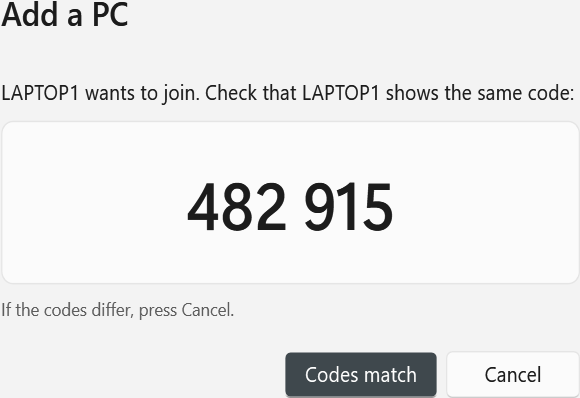
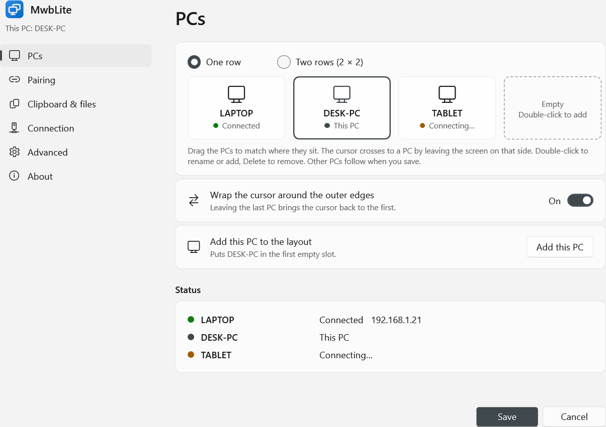

# MwbLite: standalone Mouse Without Borders

MwbLite is [Mouse Without Borders](https://learn.microsoft.com/windows/powertoys/mouse-without-borders) (MWB) carved
out of Microsoft PowerToys so it runs on its own: one tray app plus a small helper, configured by a JSON file.
It has no PowerToys runner, Settings app, updater, telemetry or Group Policy layer.

It is built from PowerToys commit `cf45de41` (see [UPSTREAM.md](UPSTREAM.md)). The networking, encryption,
input-injection and clipboard code is upstream's, unchanged apart from the lines listed in
[Changes to upstream code](#changes-to-upstream-code).

> MIT licensed, like PowerToys. [LICENSE](LICENSE) and [NOTICE.md](NOTICE.md) are upstream's; the original
> copyright headers are kept in every source file.

## Build

Requirements: Windows 10/11 x64, PowerShell 5.1 (built in), internet access for the first build. No Visual
Studio, C++ tools, WiX install or system-wide .NET SDK are needed.

```bat
build.cmd
```

That single command (a wrapper for `powershell -NoProfile -ExecutionPolicy Bypass -File build.ps1`) does four things:

1. **Installs the SDK.** It downloads the .NET SDK pinned in `global.json` into `.dotnet\` (portable). The
   Microsoft-signed `dotnet-install.ps1` is checked for a valid signature before it runs.
2. **Runs the unit tests.** These are upstream's encryption, key-codec, logger and received-file tests plus the
   config tests. Pass `-SkipTests` to skip them.
3. **Publishes the app** twice: as a shared-runtime folder for the installer, and as portable single-file exes.
4. **Builds the installer** with the [WiX Toolset](https://wixtoolset.org) 5, which comes from NuGet (MS-RL
   licence). Pass `-SkipInstaller` to skip it.

Output in `dist\`:

| File | Size | Use |
|---|---|---|
| `MwbLite-Setup-<version>.exe` | ~60 MB | **The installer.** Double-click it on each PC. |
| `MwbLite-<version>-x64.msi` | ~60 MB | The same package as a plain MSI, for silent or scripted installs: `msiexec /i MwbLite-<version>-x64.msi /qn` |
| `portable\MwbLite.exe`, `portable\MwbLite.Helper.exe` | ~177 MB each | Run without installing (see [Portable use](#portable-use-no-installer)). |
| `SHA256SUMS.txt` | | Hashes of all of the above. |

The build keeps everything inside the repo folder:

- NuGet packages go to `.nuget\` and come from nuget.org only.
- The SDK's CLI state goes to `.dotnet\home`.
- .NET CLI telemetry is switched off.

Each portable exe carries its own .NET runtime, so they are large. The installer shares one runtime between both
programs, so it's about 180 MB once installed. Neither is compressed in memory: as built, MwbLite uses about
27 MB + 15 MB of private memory, compared with about 32 MB + 17 MB for PowerToys' MWB.

## Install

**Don't run PowerToys' Mouse Without Borders on the same PC** (turn it off in PowerToys): both use TCP ports
15100/15101.

### With Setup (recommended)

Run `MwbLite-Setup-<version>.exe` on each PC: accept the licence, press **Install**, approve the UAC prompt,
then **Launch**. Setup:

- installs to `C:\Program Files\MwbLite` and adds an entry in **Settings > Apps > Installed apps** (Uninstall
  is there);
- adds **MwbLite** and **MwbLite Settings** to the Start menu;
- registers the **MwbLite.Service** Windows service (demand start; local users may start and stop it), used for
  lock screen and UAC prompt control;
- adds inbound Windows Firewall rules for `MwbLite.exe`, from the **local subnet** only: TCP (MWB and pairing) and UDP 15102 (finding PCs for pairing);
- closes running copies of MwbLite first, so re-running a newer Setup **upgrades in place** and keeps your
  settings.

**Uninstall** removes all of that, plus `%ProgramData%\MwbLite` and your start-with-Windows entry. Your own
settings in `%LOCALAPPDATA%\MwbLite` are kept.

### First-time setup: pair with a code

MwbLite starts in the tray. On first run it creates `%LOCALAPPDATA%\MwbLite\settings.json` with a random
security key and shows a balloon. Left-click the tray icon to open **Settings** (see
[Settings window](#settings-window)).

**First PC** (e.g. the mini PC): tick **Start with Windows** and press **Save & apply**. Its random key is the
one every PC will use.

**Each other PC**, one at a time, with both PCs on the same network:

1. On the first PC: Settings > **Add a PC…** It waits up to 5 minutes.
2. On the new PC: Settings > **Join…** It lists the PCs that are waiting; pick one and press **Join** (or type its
   name if it isn't listed).
3. Both PCs show the same 6-digit code. Check they match and press **Codes match** on **both**.



The new PC receives the security key, the machine list (with itself added), the layout and the port. Both PCs
save and apply them at once, and any PCs already connected pick up the new layout automatically. Then tick
**Start with Windows** on the new PC too. Drag the tiles under **Machines and layout** on any PC to match your desk; the others
follow.

You can still do it by hand instead: **Copy** the key from one PC, paste it on the others, and enter the same
machine names everywhere. See [How pairing works](#how-pairing-works).

### Lock screen and UAC prompts (service mode)

1. In Settings, tick **Service mode**, press **Save & apply**, and approve the UAC prompt. That copies your
   settings to `%ProgramData%\MwbLite`, a folder only SYSTEM and Administrators can read (see
   [Security notes](#security-notes)).
2. Exit MwbLite from the tray and start it again from the Start menu (or sign out and back in).

From then on, at sign-in:

- MwbLite starts the service and exits.
- The service launches MwbLite as SYSTEM on the secure desktop and on your desktop (exactly as PowerToys does),
  then stops itself.
- Later setting changes ask for UAC approval to update the protected copy.

### Portable use (no installer)

Copy `dist\portable\` anywhere and run `MwbLite.exe`. Windows Firewall will ask on first run; allow
**private networks**. For service mode without Setup, run `MwbLite.exe --install` (UAC). It copies the exes to
`C:\Program Files\MwbLite`, registers the service, adds firewall rules (TCP `tcpPort`, `tcpPort+1` and 15102, UDP 15102) from the local
subnet, and copies your settings to `%ProgramData%`. `MwbLite.exe --uninstall` removes it again. These two
commands do nothing on a PC where Setup installed MwbLite.

### Commands

| Command | Admin | What it does |
|---|---|---|
| `MwbLite.exe` | no | Run as a tray app. With `useService: true`, it starts the service and exits. |
| `MwbLite.exe --settings` | no | Open the Settings window. |
| `MwbLite.exe --open-config` | no | Open your settings.json in Notepad. |
| `MwbLite.exe --apply-config` | UAC | Copy your settings.json to the service's protected copy. |
| `MwbLite.exe --install` | UAC | Portable only: install service, firewall rule and Program Files copy (see above). |
| `MwbLite.exe --uninstall` | UAC | Portable only: remove what `--install` added. |
| `MwbLite.exe --service` | — | Service entry point. The Service Control Manager uses this; don't run it by hand. |
| `MwbLite.exe --set-layout …` | — | Internal: a service-mode instance uses it to save a layout received from another PC into your settings.json. |

### Tray menu

- **Settings…** Also what a left-click on the icon does. See [Settings window](#settings-window).
- **Open config file.** Opens settings.json in Notepad.
- **Reload config.** Re-reads settings.json after you edit it by hand.
- **Exit.**
- **Machines.** Below Exit, upstream's list of connected machines (click one to switch to it).

### Settings window



Left-click the tray icon, or choose **Settings…**, to edit settings.json without touching JSON.

- **Pairing.** Shows this PC's name. The security key has **Show**, **Generate** (a new random key) and
  **Copy** buttons. **Add a PC…** / **Join…** pair with a code (see
  [First-time setup](#first-time-setup-pair-with-a-code)).
- **Machines and layout.** Your PCs as tiles in MWB's 4 slots. **Drag a PC** onto another slot to move it there;
  it swaps with whatever is in that slot. **One row** places them left to right; **Two rows (2 × 2)** turns the
  slots into a grid (`[1][2]` over `[3][4]`) for a PC above or below another.
  - Double-click a tile or an empty slot to rename or add a PC; press Delete to remove one. The right-click menu
    does the same.
  - Keyboard: the arrow keys select a slot, Ctrl+arrows move the selected PC, and F2 renames.
  - This PC is highlighted. Save, and the other connected PCs take the new arrangement and save it too.

  
- **Options.** Clipboard, file transfer, start with Windows, service mode.
- **Show advanced settings.** Port, Easy Mouse, hotkeys, name-to-IP mappings and the less common switches.
- **Save & apply** validates first, using the same checks as Reload config. If something is wrong, the window
  stays open and the problem is shown in red. Otherwise it writes settings.json and applies it:
  - **Normal mode:** applied immediately.
  - **Service mode:** a UAC prompt copies it to the service's protected copy.
  - **Service mode turned on but not installed yet:** the window offers the one-time install.
- **Saving rewrites settings.json.** Comments are removed (you're asked first), and the previous file is kept as
  `settings.json.bak`. Values the window doesn't show (e.g. `easyMouseFullscreenExcludedApps`) are kept.
- **Open JSON…** opens the file in Notepad for anything else.
- **It runs as you.** In service mode the tray belongs to a SYSTEM process, so the window opens as a separate
  `MwbLite.exe --settings` process with your token, never as SYSTEM.

## Arranging the PCs

Open Settings and drag the tiles under **Machines and layout** until they match where the PCs sit on your desk,
then press **Save & apply**. The cursor moves to a PC by leaving the screen on that side.

- **One row:** tiles left to right. With `LAPTOP1, MINIPC, LAPTOP2`, the mini PC's left edge leads to LAPTOP1 and
  its right edge to LAPTOP2.
- **Two rows (2 × 2):** for a PC above or below another. Leave a slot empty where there's no PC; that edge then
  doesn't switch.
- **Wrap the cursor around the outer edges:** leaving the last PC brings you back to the first. Untick it to cross
  only between PCs that are next to each other.
- **Each PC counts as one screen**, however many monitors it has. MWB uses the outer edges of that PC's whole
  desktop; the edges between its own monitors work as normal Windows.
- **Offline PCs and empty slots are skipped.** With LAPTOP1 asleep, the cursor goes to the next PC that's online.
- **Keyboard:** Ctrl+Alt+F1…F4 jump to the PC in slot 1…4. To use Ctrl+Alt+1…4 instead, change "Switch to PC"
  under advanced settings.
- **Only two shapes:** MWB supports a row of up to 4 or a 2×2 grid, not free-form positions.

## Copying files between PCs

It needs **Share the clipboard** and **Transfer files** turned on (both are on by default). You can send a
single file, **several files, or folders**, in either direction between any two paired PCs.

- **Copy and paste.** In Explorer, select files and/or folders and press Ctrl+C. Move the cursor to the other PC,
  click where you want them (a folder in Explorer, or the desktop) and press **Ctrl+V**.
  - The data is fetched when you switch to the other PC. It's kept in a temporary folder
    (`Desktop\MwbLite\ScreenCaptures`, cleared after a day) and put on that PC's clipboard, so you can paste it
    anywhere.
  - Limit: **100 MB in total**.
- **Drag and drop.** Drag files and/or folders out of Explorer, across the screen edge onto the other PC, and
  drop them. They are saved to the **`MouseWithoutBorders`** folder on that PC's desktop, which then opens.
  There's **no size limit**.

**How folders and multiple files work.** MWB itself sends exactly one file at a time, and that is unchanged.
MwbLite packs a selection with folders or several files into one zip as soon as you copy it or start dragging. It
sends that zip as the one file, and the receiving MwbLite unpacks it again: folder structure, empty folders and
hidden files are kept, and existing items get "(2)" rather than being overwritten. A PC running stock Mouse
Without Borders would receive the zip itself.

**Very large folders** (several GB) take time to pack. If you drop before packing finishes, the other PC shows
"…still being packed. Try again in a moment"; drop again once it's ready. Drag and drop sends the zip
uncompressed, for speed. Copy and paste compresses it.

All transfers use the same encrypted connection as everything else.
## Configuration: `%LOCALAPPDATA%\MwbLite\settings.json`

The file is JSON. `//` comments and trailing commas are allowed. Three things write it:

- MwbLite creates it when it's missing.
- The Settings window rewrites it when you press **Save & apply**, or after pairing.
- A layout change received from another of your PCs (machines, one row/two rows, wrap) is saved into it.

Each write keeps the previous file as `settings.json.bak`.

Values MWB changes while running (machine IDs, learned machine pool, last cursor position) go to `state.json`
next to it.

```jsonc
{
  "securityKey": "<16+ characters, identical on every PC>",
  "machines": ["LAPTOP1", "MINIPC", "LAPTOP2"],   // up to 4; order = screen layout
  "layout": { "oneRow": true, "wrapMouse": true },
  "shareClipboard": true,
  "transferFile": true,
  "startWithWindows": true,
  "useService": true,
  "advanced": {
    "tcpPort": 15100,
    "hideMouseAtScreenEdge": true,
    "drawMouseCursor": true,
    "validateRemoteIp": false,
    "sameSubnetOnly": false,
    "blockScreenSaverOnOtherMachines": true,
    "moveMouseRelatively": false,
    "blockMouseAtScreenCorners": false,
    "showClipboardAndNetworkStatusMessages": false,
    "easyMouse": "enable",
    "disableEasyMouseWhenForegroundWindowIsFullscreen": true,
    "easyMouseFullscreenExcludedApps": [],
    "name2Ip": ["LAPTOP1 192.168.1.21"],
    "hotkeys": {
      "switchMachine": "F1",
      "toggleEasyMouse": "Win+Ctrl+Alt+E",
      "lockMachine": "Win+Ctrl+Alt+L",
      "reconnect": "Win+Ctrl+Alt+R",
      "switchToAllPcs": ""
    }
  }
}
```

| Key | Default | Meaning |
|---|---|---|
| `securityKey` | random | Pairing key. At least 16 characters; spaces are ignored. **Must be identical on every PC.** MWB derives its AES key from it. |
| `machines` | this PC | Up to 4 computer names (`hostname`), in screen order. **Keep this identical on every PC.** Use `""` for an empty slot. If this PC is missing, MWB puts it in the first empty slot. |
| `layout.oneRow` | `true` | `true`: machines left-to-right. `false`: 2×2 grid, row by row (`[0][1]` over `[2][3]`). |
| `layout.wrapMouse` | `true` | Leaving the last screen wraps the cursor to the first. |
| `shareClipboard` | `true` | Sync clipboard text and images. |
| `transferFile` | `true` | Copy or drag files between PCs, up to 100 MB, single file. Requires `shareClipboard`. Received files go to a `MouseWithoutBorders` folder on the desktop. |
| `startWithWindows` | `false` | Adds or removes a per-user `HKCU\…\Run` entry. **Required for service mode** to start at logon. |
| `useService` | `false` | Use MwbLite.Service, so MWB controls the lock screen, Ctrl+Alt+Del and UAC prompts. Needs `--install`. Takes effect after a restart. |
| `advanced.tcpPort` | `15100` | MWB uses `tcpPort` (clipboard and files) and `tcpPort+1` (input and control). Must match on every PC. Takes effect after a restart. |
| `advanced.validateRemoteIp` | `false` | Reverse-DNS check of connecting machines. |
| `advanced.sameSubnetOnly` | `false` | Only connect to machines on the same subnet. |
| `advanced.name2Ip` | `[]` | Static `"NAME IP"` mappings, used when name resolution is unreliable. |
| `advanced.easyMouse` | `enable` | `enable` (cross edges freely), `disable` (hotkeys only), `ctrl` or `shift` (hold the key to cross). |
| `advanced.hotkeys.*` | upstream defaults | `"Win+Ctrl+Alt+E"` style strings; `""` disables a hotkey. `switchMachine` is `"F1"` (Ctrl+Alt+F1…F4), `"1"` (Ctrl+Alt+1…4) or `"disabled"`. |
| other `advanced.*` | upstream defaults | Same meaning as the PowerToys MWB settings with the same names. |

**Reload config** validates the file first. If it's invalid, nothing changes and a balloon names the problem.
If settings.json is invalid at startup, MwbLite runs with a random key, so nothing can connect until you fix the
file and reload. `tcpPort` and `useService` changes need a restart: Exit, then start `MwbLite.exe` again.

### File locations

| Path | Contents |
|---|---|
| `%LOCALAPPDATA%\MwbLite\settings.json` | Your configuration. |
| `%LOCALAPPDATA%\MwbLite\state.json` | Runtime values (normal mode). |
| `%LOCALAPPDATA%\MwbLite\logs\` | `mwblite.log`, `helper.log`, `commands.log` (4 MB cap each, one `.1` rollover). |
| `%ProgramData%\MwbLite\` | Service mode: protected copy of settings.json, state.json, and logs (`mwblite-system.log`, `service.log`, `install.log`). SYSTEM and Administrators only. |
| `C:\Program Files\MwbLite\` | Installed binaries (`--install`). |

## How pairing works

PCs trust each other because they share the **security key**; there is no per-device approval. Getting the same
key and the same machine list onto every PC *is* pairing. You can do it in two ways:

- **With a code** (Settings > Add a PC… / Join…). This is a separate, short-lived exchange in front of MWB:
  1. The joining PC finds PCs in "Add a PC" mode with a UDP broadcast on port 15102, or uses the name you typed.
  2. It connects to TCP 15102 and the two PCs run an elliptic-curve Diffie-Hellman exchange (P-256). The joining
     PC first commits to its key with a hash (as in Bluetooth "compare numbers" pairing), so an attacker can't
     search for keys that make both screens match.
  3. Both PCs derive the same 6-digit code from the exchange and show it. You confirm it on **both** PCs.
  4. Only then does the existing PC send the security key, the machine list (with the new PC added), the layout
     and the port, encrypted with AES-256-GCM. Both PCs save and apply them.

  Everything uses .NET's built-in cryptography. "Add a PC" accepts one PC per session, for up to 5 minutes; if
  the codes differ, press Cancel and nothing changes.
- **By hand.** Copy the key and type the same machine names on every PC.

**Once paired, MWB connects** using upstream's protocol, unchanged. Each PC connects to the others by name on
TCP `tcpPort`+1 (input and control) and `tcpPort` (clipboard and files). Each connection derives an AES-256 key
from the security key (PBKDF2-SHA512, 100,000 iterations, fresh random salt and IV). A challenge-response
handshake proves both sides have the key; a wrong key is dropped after 10 bad packets. The key itself never
crosses the network after pairing.

**Layout** (machine order, one row or two, wrap) is shared. A change made in Settings on one PC is sent to the
connected PCs, and each saves it to its own settings.json. MwbLite also pre-loads the configured names into MWB's
machine pool, as upstream's pairing did. Without that, MWB would reorder the layout the first time it met a PC
it didn't know.

**To remove a PC or revoke a key**, press **Generate** on one PC and pair the PCs you want to keep again (or copy
the new key to them). A PC with the old key can no longer connect.

## What was removed or replaced

| Upstream (PowerToys) | MwbLite |
|---|---|
| PowerToys runner and C++ module interface (`ModuleInterface`, launches MWB, registers the service, firewall action, hotkeys) | `MwbLite.exe` runs by itself. Service registration and the firewall rule moved into `--install` (C#). |
| Settings pipeline: `Settings.UI.Library`, `SettingsUtils`, a PowerToys settings.json watcher, the Settings app pairing UI over named-pipe IPC (`StartSettingSyncThread`, `MouseWithoutBordersIpc`, `NamedPipePeerVerification`) | `Lite/LiteConfig.cs` reads `%LOCALAPPDATA%\MwbLite\settings.json`; `Lite/LiteState.cs` holds runtime values; the tray offers Reload. The IPC server is removed. |
| Logging via `ManagedCommon.Logger` and the Windows Event Log (`EventLogger`) | `Lite/LiteLog.cs`, a size-capped local file. |
| Telemetry: `ManagedTelemetry`, `ETWTrace`, 7 telemetry event types, 6 `WriteEvent` calls | Removed. |
| Group Policy: `GPOWrapper` (C++/WinRT), 10 policy checks | Removed. There is no policy layer. |
| "Exit when PowerToys exits" watcher (`ShutdownWithPowerToys`, `RunnerHelper`) | Removed. |
| Command Palette named events (`CommandEventHandler`, `PowerToys.Interop` constants) | Removed. The same actions remain on the MWB hotkeys. |
| Classic MWB settings form and setup wizard (opened from the tray) | Still compiled but unreachable. Every path that opened them opens settings.json instead. |
| Root build (C++ toolchain, vcpkg, Azure Artifacts feed, StyleCop, CsWinRT preview SDK package) | `Directory.Build.props` and `Directory.Packages.props` with the same package versions, from nuget.org, .NET SDK only. |
| `PowerToys.MouseWithoutBorders[Helper\|Service].exe`, service `PowerToys.MWB.Service` | `MwbLite.exe` (+ `--service`), `MwbLite.Helper.exe`, service `MwbLite.Service`. |

No PowerToys DLLs or projects are referenced. The build contains no C++.

## Changes to upstream code

**Engine files left byte-for-byte unchanged:**

- **Crypto and keys:** `Core/Encryption.cs`, `Class/PairingKeyCodec.cs`, `Class/PassthroughPairingKeyCodec.cs`, `Class/DpapiPairingKeyCodec.cs`.
- **Network and protocol:** `Class/TcpServer.cs`, `Core/Receiver.cs`, `Core/Package*.cs`. (`Class/SocketStuff.cs` has one small edit, listed below; the bytes on the wire are unchanged.)
- **Input injection:** `Class/InputSimulation.cs`.
- **Process launch and native calls:** `Core/Launch.cs`, `Core/WinAPI.cs`, `Class/NativeMethods.cs`.

**Engine files with minimal, necessary edits** (`git diff baseline -- <file>` shows each one):

| File | Change | Why |
|---|---|---|
| `Class/InputHook.cs` | The module handle passed to `SetWindowsHookEx` is now `GetModuleHandle(NULL)` instead of `Marshal.GetHINSTANCE(module)`. | In a single-file exe `GetHINSTANCE` returns -1, so the keyboard and mouse hooks failed with error 126. Verified: they now install. |
| `Core/Clipboard.cs`, `Core/DragDrop.cs` | One telemetry line removed from each. | No telemetry. |
| `Class/SocketStuff.cs` (send step), `Core/Clipboard.cs` (receive step), `Helper/FormHelper.cs` (copy and drag) | A selection with folders or several files is announced as a bundle. The sender asks `Lite/LiteFileBundle` for the bundle's zip, and the receiver unpacks it. A single file takes the original path. | Copying folders and several files at once. MWB still transfers exactly one file, with the same header and data. |
| `Core/Helper.cs`, `Helper/FormHelper.Designer.cs`, `Class/IClipboardHelper.cs` | Helper process and window renamed to `MwbLite.Helper` / "MwbLite Helper". Local clipboard pipe renamed to `MwbLite/ClipboardHelper`. `EventLogger` now writes to the log file. | These names were shared with PowerToys MWB. With both installed, MwbLite found PowerToys' helper window, and the pipe could connect to the wrong app. They are local IPC between MwbLite's own two processes, not the network protocol. |

The other edited files are the PowerToys seams: `Class/Program.cs`, `Class/Setting.cs` (same members, new backing
store), `Class/IpcChannel.cs`, `Core/Logger.cs`, `Core/MachineStuff.cs` (`ShowMachineMatrix`), `Form/frmScreen.cs`
(tray menu), `Form/frmMatrix.cs` (one telemetry line), `Helper/Program.cs`, `Service/*.cs`. New code lives in
`src/App/Lite/`.

### Stubs (fixed values that replace removed features)

| Member | Value | Note |
|---|---|---|
| `Settings.*IsGpoConfigured` (6 properties), `Name2IpPolicyListIsGpoConfigured` | `false` | Only read by the unreachable classic settings form. |
| `Settings.Name2IpPolicyList` | `""` | Policy-defined name/IP rules came from Group Policy. |
| `Settings.FirstRun` | `false` | The setup wizard is replaced by settings.json. |
| `Settings.ShowOriginalUI` | `true` | Upstream hid MWB's own tray icon when PowerToys owned the UI. The tray icon is MwbLite's only UI. |
| `Settings.DrawMouseEx` | `true` | Upstream default; it wasn't exposed in any UI. |

Upstream already hard-coded `DisableCAD`, `HideLogonLogo`, `MyKeyDaysToExpire`, `SendErrorLogV2`,
`StealFocusWhenSwitchingMachine`, `OneWay*Mode` and `HotKeyExitMM`; those are unchanged.

### Dependency changes

- **MessagePack** goes from 3.1.7 (upstream pin) to **3.1.9**, which fixes
  [GHSA-qhrr-8q5h-9q3h](https://github.com/advisories/GHSA-qhrr-8q5h-9q3h) (published 2026-10-15). It is a
  transitive dependency of StreamJsonRpc; MWB's code doesn't call it.
- All other packages use upstream's versions.

## Security notes

- **Traffic:** MWB traffic is encrypted with a key derived from `securityKey` (upstream `Encryption.cs`,
  unchanged). Anyone with the key can control your PCs. Treat settings.json like a password and use the random
  default or another long key.
- **The SYSTEM instance never reads a user-writable config.** In service mode, MWB runs as SYSTEM on the secure
  desktop and can click "Yes" on UAC prompts. If it trusted a key from a file the user (or malware running as the
  user) can edit, that would be a UAC bypass. So it reads `%ProgramData%\MwbLite\settings.json`, which is
  ACL-restricted to SYSTEM and Administrators, and changes require UAC approval (`--apply-config`).
  - **Where this differs from upstream:** PowerToys kept the service key DPAPI-encrypted inside the user's
    settings file. MwbLite keeps it as plain text in a folder only admins can access.
- **No editor or settings window runs as SYSTEM.** The SYSTEM tray's "Settings…", "Open config file" and "Reload
  config" start `MwbLite.exe --settings` / `--open-config` / `--apply-config` with **your** token.
- **Install location:** the service binary lives in `C:\Program Files\MwbLite` (admin-only write), never in a
  user-writable folder.
- **Firewall:** the rules (Setup or `--install`) allow only `MwbLite.exe`, from the local subnet. Upstream
  allowed the program from any address.
- **Pairing with a code** hands over the security key only after you confirm the same 6-digit code on both PCs.
  The exchange uses ECDH (P-256) with a hash commitment and AES-256-GCM, built from .NET's own cryptography. An
  attacker on the network gets one guess in a million at making both screens match. `Add a PC` accepts one PC per
  session, for up to 5 minutes. See [How pairing works](#how-pairing-works).
- **No outbound calls** other than to the MWB peers you configure: no telemetry, update checks or crash
  reporting.

## Known limitations

- **Simple settings UI only.** The Settings window replaces the classic MWB settings form and setup wizard. The
  screen-capture menu items, "About" and "Generate log" are hidden.
- **Up to 4 machines** (MWB limit). The layout is shared: MWB sends layout changes to the connected PCs and each
  one saves them. If two PCs are edited at the same time, the last change wins.
- **Easy Mouse toggled by hotkey is not saved**; it returns to the setting in settings.json on restart.
- **Service mode starts at logon.** The service is demand-start (as in PowerToys) and is started by the Run entry
  when you log on. Lock screen and UAC control therefore work after your first logon, not at the cold-boot login
  screen.
- **Not code-signed yet.** SmartScreen shows "Windows protected your PC" on first run (More info > Run anyway),
  and Smart App Control, if turned on, blocks MwbLite outright. See
  [Sharing MwbLite with other people](#sharing-mwblite-with-other-people).
- **Local network only.** The firewall rule admits peers on the same subnet, which covers a typical home or
  small-office network. PCs on different subnets or VLANs, or connected over a VPN (e.g. Tailscale), need a
  wider firewall rule, added by an administrator.
- **x64 only.** Windows on ARM PCs would run the x64 build under emulation; that is untested.
- **Not tested against stock PowerToys MWB.** The wire protocol and key derivation are unchanged, so mixed setups
  should work, but this has not been tested.
- **Updates are manual.** See below.
- **Notepad is always used** by "Open config file", not your default `.json` editor.

## Sharing MwbLite with other people

MwbLite is MIT licensed, so you can give `MwbLite-Setup-<version>.exe` to anyone. Keep the `LICENSE` and
`NOTICE.md` that ship with it (Setup also shows the licence), and don't present it as a Microsoft product.

### Code signing

Windows decides how much to trust a downloaded program from its **digital signature**. Unsigned, MwbLite works,
but other people will see SmartScreen warnings, and PCs with **Smart App Control** turned on will refuse to run
it. Signing needs a code-signing certificate issued to you after an identity check. That can't be produced here;
you obtain it. The build is ready for it.

| Option | Roughly | Notes |
|---|---|---|
| **Azure Trusted Signing** (Microsoft) | Low monthly fee | Cheapest publicly trusted option. Identity validation is required, and eligibility for individuals depends on country; check the current Microsoft rules. |
| **OV code-signing certificate** from a CA (e.g. Sectigo, SSL.com, DigiCert) | Low hundreds of USD per year | Since 2023 the key must live on a hardware token or cloud HSM. |
| **Self-signed certificate** | Free | Only trusted on PCs where you import it. Fine for your own PCs, useless for strangers. |

None of these makes the SmartScreen warning disappear on day one. SmartScreen also builds reputation per
publisher from downloads, so a new signature still warns for a while.

Once you have a certificate, sign everything (both exes and their DLLs, the MSI, its cabinet, and the Setup engine
and bundle) in the same build:

```bat
build.cmd -CertThumbprint <SHA-1 thumbprint of your certificate>
build.cmd -SignToolArgs "/fd SHA256 /tr http://timestamp.acs.microsoft.com /td SHA256 /dlib <path>\Azure.CodeSigning.Dlib.dll /dmdf <path>\metadata.json"
```

`signtool.exe` is fetched from Microsoft's Windows SDK build-tools package on nuget.org (signature-checked), so
the Windows SDK doesn't need to be installed.

## Updating from upstream

```bash
git -C upstream fetch --depth 1 origin main && git -C upstream checkout FETCH_HEAD
git diff --no-index upstream/src/modules/MouseWithoutBorders/App src/App
```

1. Compare the new upstream against the `baseline` tag (the unmodified import) to see what upstream changed.
2. Port those changes onto `src/App`.
3. Pay particular attention to security fixes in `Encryption.cs`, `SocketStuff.cs`, `Receiver.cs` and
   `Clipboard.cs`.

The `upstream/` folder is a sparse clone that `.gitignore` excludes. Re-create it with:

```bash
git clone --depth 1 --filter=blob:none --sparse https://github.com/microsoft/PowerToys.git upstream
git -C upstream sparse-checkout set src/modules/MouseWithoutBorders src/settings-ui/Settings.UI.Library
```

## Testing

- **Unit tests** run as part of `build.cmd`.
- **Two-machine test:** follow [docs/TEST-PLAN.md](docs/TEST-PLAN.md).
